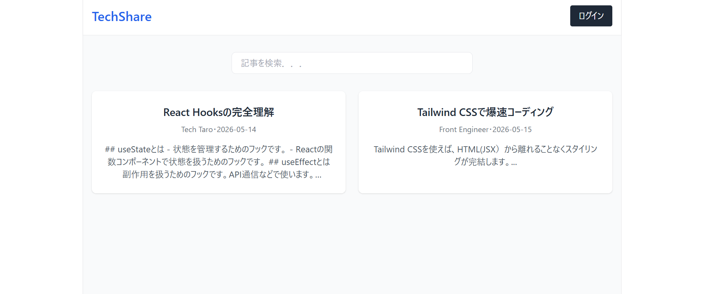
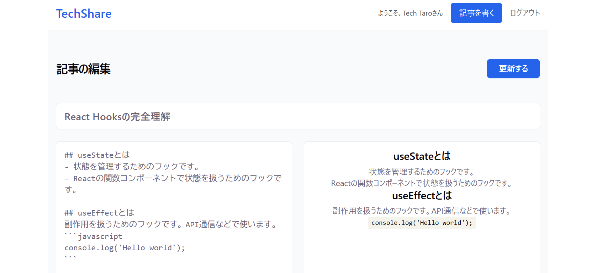

#　TechShare - 技術記事共有アプリ

## 概要
技術記事を投稿・閲覧・検索できるWebアプリです。
職業訓練で学んだことをアウトプットする場として設計しました。

🔗**デモ**：https://unit16-eight.vercel.app/

## 画面

## 技術スタック
| 技術 | 選定理由 |
|---|---|
| React | コンポーネント設計により可読性の高い開発をするため |
| Vite | 開発サーバーの起動速度が速いため |
| Tailwind CSS | スタイリングの開発速度を高めるため |
| json-server | バックエンドの開発途中でもAPIレスポンスを再現できるため |
| React Router | SPAでのスムーズなページ遷移を実現するため |

## 工夫したポイント
- Atomic Designに基づいてコンポーネントを設計し、共通テンプレートとしてLayout.jsxにて全ページに統一されたヘッダーを作成しました。
- 検索ロジックをuseSearchカスタムフックに分離することで、検索要件の変更があった場合の保守性を高めるとともにuseMemoを活用して記事一覧が変わらない限り再計算しないよう最適化しました。
- Context APIでログイン状態をグローバルに管理しました。

## セットアップ
1.動作環境
    本アプリケーションをローカル環境で起動するには、以下のソフトウェアが必要です。
    ・Node.js
    ・npm
    ・Git

2.リポジトリのクローン
    以下のコマンドを実行し、Githubからソースコードを取得します。

    クローンしたプロジェクトのディレクトリへ移動します。
    cd Unit16

3.パッケージのインストール
    以下のコマンドを実行し、アプリケーションの実行に必要なパッケージをインストールします。
    npm install

4.ＡＰＩサーバーの起動
    以下のコマンドを実行し、JSON Severを起動します。
    npm run server
    記事データを取得・保存するためのＡＰＩサーバーが起動します。

5.アプリケーションの起動
    別のターミナルを開き、同じプロジェクトディレクトリで以下のコマンドを実行します。
    npm run dev
    起動後、ブラウザでＵＲＬにアクセスしてください。

6.終了方法
    アプリケーションとAPIサーバーを終了する場合は、それぞれ起動しているターミナルで　ctrl + c　を押してください。

# React + Vite

This template provides a minimal setup to get React working in Vite with HMR and some Oxlint rules.

Currently, two official plugins are available:

- [@vitejs/plugin-react](https://github.com/vitejs/vite-plugin-react/blob/main/packages/plugin-react) uses [Oxc](https://oxc.rs)
- [@vitejs/plugin-react-swc](https://github.com/vitejs/vite-plugin-react/blob/main/packages/plugin-react-swc) uses [SWC](https://swc.rs/)

## React Compiler

The React Compiler is not enabled on this template because of its impact on dev & build performances. To add it, see [this documentation](https://react.dev/learn/react-compiler/installation).

## Expanding the Oxlint configuration

If you are developing a production application, we recommend using TypeScript with type-aware lint rules enabled. Check out the [TS template](https://github.com/vitejs/vite/tree/main/packages/create-vite/template-react-ts) for information on how to integrate TypeScript and Oxlint's TypeScript related rules in your project.
